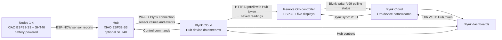

# System Architecture

## Overview

The system has three physical parts: up to four battery-powered temperature
nodes, a powered Hub, and a remote Orb controller with five displays. Blynk
Cloud stores the latest datastream values for each device and provides the
dashboards. The nodes do not need Wi-Fi network access or Blynk accounts.
The Hub and Orbs each need internet access, but they do not need to be on the
same network or within radio range of each other.

The Hub and Orb are separate Blynk devices with separate auth tokens. They
may use the same template, but a template shares datastream definitions,
not the values stored for each device. The Orb therefore queries the **Hub
device** using the Hub token, rather than syncing its own sensor pins.
No Blynk device-to-device forwarding automation is required.

## Components and communication

### Nodes to Hub

- Each Seeed Studio XIAO ESP32-S3 node reads an SHT40 sensor and battery
  voltage, sends its node ID and readings over ESP-NOW, and sleeps for
  approximately 30 minutes from the start of deep sleep.
- A node pairs with the Hub during an open pairing window and stores its
  Hub MAC address and Wi-Fi channel. ESP-NOW uses the radio but the nodes
  do not join the Hub's Wi-Fi network. Both ends must use the same channel.
  If the Hub's router channel changes, nodes may need to be re-paired.
- The Hub stores the latest pending packet per node in RAM; a newer packet
  replaces an older one while publication is pending. A radio acknowledgement
  is not confirmation that Blynk received the reading.
- ESP-NOW reports and pairing are currently **unencrypted and
  unauthenticated**. A pairing window does not protect against impersonation.

### Hub to Blynk

The powered Hub joins Wi-Fi using Blynk.Edgent provisioning, receives node
reports, optionally samples its own SHT40, and publishes to its own Blynk
device. Node reports are published when available and connected; the local
sensor is sampled approximately every 30 minutes. The Hub checks and
publishes contact status approximately once per minute while connected.

The Hub uses `Blynk.virtualWrite` on its Blynk connection. In the current
Temperature Nodes firmware, `beginGroup` / `endGroup` give grouped values a
shared timestamp; they **do not** combine the writes into a single HTTPS
batch request. Demo mode publishes simulated values every 30 seconds; they
are not real sensor readings or node status.

The Hub calculates node offline status after 90 minutes without a report
and sends the `node_offline` event once per offline period. It also emits
`low_battery` for reported voltages above 2.50 V and below 3.40 V.
Dashboard controls V40, V41, and V100 respectively request node pairing
reset, open a pairing window, and enable or disable demo mode.

### Blynk to Orbs

The Orb controller is an `esp32doit-devkit-v1` driving five GC9A01 displays
over shared SPI with separate chip-select pins. It uses its own provisioned
Blynk connection and a separate, certificate-verified HTTPS connection to
fetch the Hub's saved datastreams.

1. The user enters the Hub device's auth token in **V101 on the Orb
   device's dashboard**. The Orb syncs V101 on each Blynk connection and
   also accepts changes while connected. It retains this token only in
   memory; it is not compiled into the firmware or saved by the Orb
   application across restarts.
2. With a valid token, Wi-Fi, and synchronized internet time, the Orb sends
   one HTTPS `getAll` request for the Hub's saved values. It waits 10 seconds
   after each request before the next poll. Polling is performed in a
   separate task, and results are passed to the display loop.
3. The Orb reads the relevant Hub values and updates its displays. It does
   not mirror those sensor values into its own Blynk datastreams.
4. The Orb writes its polling result to **V99 on the Orb device**, on
   change and after reconnecting to Blynk.

The Orb uses `blynk.cloud` by default; a regional hostname may be required
if Blynk responds with HTTP 308. The HTTPS API request rate depends on the
poll interval and should be checked against the Blynk plan.

## Datastreams and displays

These are datastreams on the **Hub device**. Temperatures are in Fahrenheit
and humidity is relative humidity. The Orb displays temperatures without
converting them again.

| Source | Orb display | Temperature | Humidity | Node contact | Battery percentage | Battery voltage |
| --- | --- | --- | --- | --- | --- | --- |
| Hub sensor | Orb 1 | V8 | V9 | V14 (not displayed) | - | - |
| Node 1 | Orb 2 | V0 | V4 | V10 | V30 | V20 |
| Node 2 | Orb 3 | V1 | V5 | V11 | V31 | V21 |
| Node 3 | Orb 4 | V2 | V6 | V12 | V32 | V22 |
| Node 4 | Orb 5 | V3 | V7 | V13 | V33 | V23 |

The Orb requests all Hub datastreams in one API call, but decodes V0-V13
and V30-V33 only. It does not display V14 or read V20-V23. Node battery
percentage is displayed in red below 10%.

| Orb-device pin | Type | Direction | Purpose |
| --- | --- | --- | --- |
| V101 | String | Dashboard to Orb | Hub device auth token |
| V99 | String | Orb to dashboard | `Online` or `Offline` Hub-data polling status |

Both V99 and V101 belong to the **Orb device**, not the Hub device. Configure
them in the Orb device's template and dashboard. Refer to the Hub project's
README for node wiring, pairing, Hub controls, and Hub datastream setup.

## Status, freshness, and failures

- **Orb 1 connection:** Its status label indicates the Orb's own
  Wi-Fi/Blynk connection, not the Hub's connection.
- **V99:** `Online` means the latest HTTPS request returned at least one
  usable Hub value. `Offline` means polling failed or a valid token is
  unavailable. It is not the Hub's live connection state: Blynk may return
  saved readings even when the Hub is offline. If the Orb disconnects from
  Blynk, the dashboard can retain the last V99 value until it reconnects.
- **Hub display receipt time:** `Updated` is the Orb's local receipt time
  of a successful Hub request in Los Angeles time, including daylight
  saving time. It is not the time the Hub or node took a measurement. The
  HTTPS response does not provide source timestamps for these values.
- **Failed or incomplete requests:** Failed polling leaves previous values
  visible, marks the Hub data stale, and makes node statuses `Unknown`.
  A response missing expected values is marked incomplete; old values may
  remain visible. Successful polling alone does not establish freshness.
- **Node contacts:** The Hub sends `--:--` before a valid contact time, an
  unprefixed 12-hour time for an online node, or `OFFLINE` plus the time
  after a timeout. The Orb recognizes prefixed clock times and legacy
  elapsed times, but currently does **not** recognize the Hub's unprefixed
  12-hour online time; it shows `Unknown` for it. A missing or
  unrecognized value also shows `Unknown`. Demo mode's `ONLINE --:--` is
  unrecognized until the Hub clock is synchronized.
- **Clock:** The Hub and Orb synchronize time over the internet. A Hub
  reading received before clock synchronization can have `--:--` until a
  later report; the Orb waits for time synchronization before HTTPS polling.

## Credentials and storage

Blynk stores device datastream values separately for the Hub and Orb.
Edgent stores each device's own provisioning information on that device.
Node pairing information persists on the node, while pending Hub packets are
held in RAM. The Hub token placed in Orb V101 is stored in Blynk and used by
the Orb in memory; access to that Orb datastream exposes the token. Restrict
dashboard and account access, never share tokens or unredacted diagnostic
logs, and rotate a token if it is exposed.

These descriptions reflect the current firmware; end-to-end operation,
especially after a change in network, token, or device configuration,
should be verified on the actual hardware.
